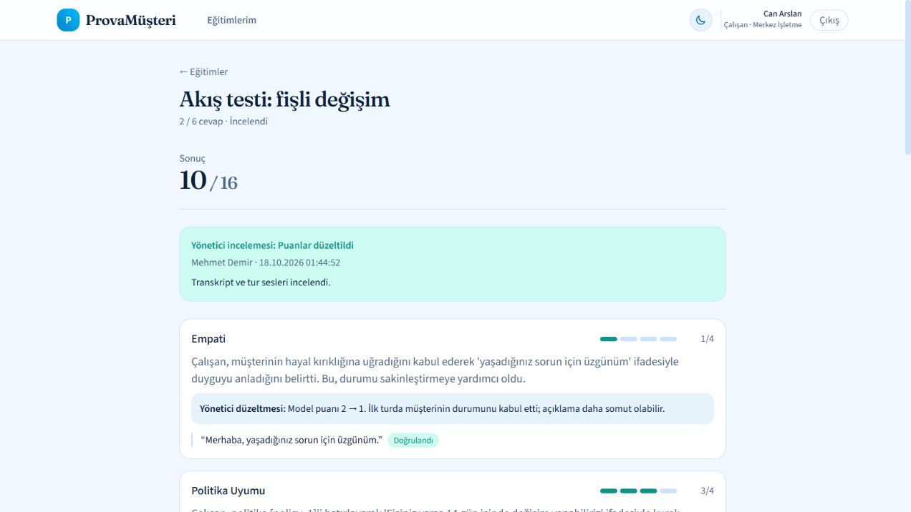
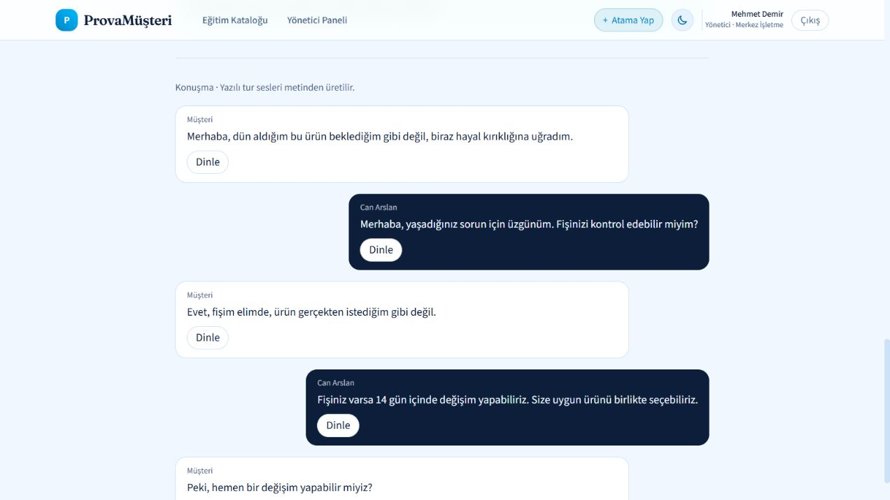

# Yönetici akışı doğrulaması — 18 Ekim 2026

Görseldeki Akış 1 listesi mevcut kod, API testleri, gerçek model/Piper entegrasyonu ve tarayıcıyla karşılaştırıldı.

| İş | Sonuç |
| --- | --- |
| Rol bazlı giriş | Mehmet yönetici paneline yönlenir. Can'ın `/admin/overview` girişi ana sayfaya yönlenir; yönetici API'si 403 döner. |
| Özet | Aktif çalışan, açık/tamamlanmış atama, inceleme bekleyen ve son 7 gün sayaçları mevcut. `/admin/overview` yolu eklendi. |
| Çalışanlar | Liste, arama, aktif/pasif filtre, ekleme, pasifleştirme ve detay arayüzleri mevcut; backend regresyonları geçti. |
| Oturumlar | İnceleme/değerlendirme durumu, çalışan, eğitim ve tarih filtreleri mevcut. |
| Oturum inceleme | Transkript, her tur için dinleme, rapor, açık doğrulama rozetleri, politika referansları ve gerekçeli düzeltme mevcut. |
| Atama | Eğitim, birden çok çalışan ve isteğe bağlı son tarih mevcut. Yayımlanan taslaktan eğitim seçili atama kısayolu eklendi. |
| Taslak | Form, iş durumu/hata, senaryo-politika-rubrik düzenleme, uyarılar, yayımlama mevcut. Kaydetme/yayımlama 409 sonrası güncel sürümü inceleme eklendi. |
| Çalışanın sonucu görmesi | Can'ın tamamlanan atamasından rapora erişmesi, düzeltme/gerekçe/sonuç görüntüsü tarayıcıda doğrulandı. Tamamlanan raporlar 15 saniyede güncellenir. |

## Eklenen ve düzeltilenler

- Yerel Piper Türkçe sesi kuruldu ve bu makinede API/worker için etkinleştirildi. Yeni yazılı çalışan ve müşteri turları WAV olarak saklanır; yüklenen özgün ses varsa korunur.
- Ses üretimi kesildiğinde tekrar denemede müşteri turunun kimliğinin kalıcı iş durumuna yazılmaması bulundu. JSON durum güncellemeleri kopya sözlükle yapılır; aynı tur tekrar oluşturulmaz.
- Ses oynatma hatası artık görünür; başarısız `play()` çağrısı oynuyor olarak gösterilmez.
- Kanıtlarda ve politika referanslarında doğrulandı/doğrulanamadı bilgisi gösterilir.

## Kanıt ve kontroller

- Backend: **75 geçti, 1 atlandı** (Windows'ta macOS `say` testi).
- Frontend: `npm run build` başarılı. Zod bağımlılığından mevcut Rollup yorum uyarısı bulunuyor.
- `eval/manager_flow_real.py`: gerçek Gemma/Ollama + Piper ile iki kez başarılı. Varsayılan çalışma geçici DB/media kullanır.
- Mehmet taslak üretir → senaryo düzenler → eski sürüm kaydetme/yayımlamada 409 alır → güncel sürümü yayımlar → Can'a son tarihli atar → Can iki yazılı cevap verir → Mehmet beş turun sesini alır → gerçek rapor oluşur → puanı gerekçeyle düzeltir → Can güncel raporu görür → atama tamamlanır.
- Beş WAV dosyasının süreleri, MIME türleri ve HTTP Range (206) yanıtları doğrulandı. Tarayıcıda çalışan turunun Dinle düğmesi Durdur'a geçti; hata görünmedi.
- Test verileri gerçek uygulamanın veritabanından ayrı tutuldu.

## Kapsam

Bu tamamlanma yazılı prova akışı içindir: sesler metinden üretilir, çalışanın gerçek ses/ton kaydı değildir. Önceki sessiz oturumlara geriye dönük ses eklenmez. Mikrofonla prova bu Windows arayüzünün kapsamına eklenmedi.

Ses modeli kurulumu ve lisans notları README içindedir. İndirilen dfki model kartı veri kümesi için CC BY-NC-SA 4.0 belirtir; ticari ürün için uygun lisanslı model gerekir. Model dosyaları repoya eklenmez.
