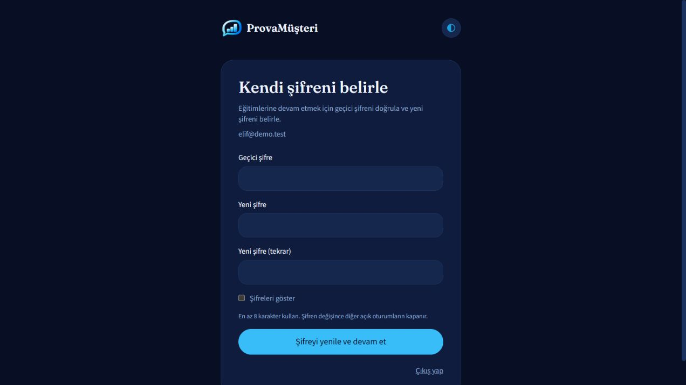

# Şifre yenileme ve tema kontrolü — 18 Ekim 2026

Pull sonucu `main` zaten günceldi (`af88492`).

## Şifre akışı

- Yeni çalışan hesapları `must_change_password=true` ile açılır. Girişten sonra `/change-password` ekranı zorunludur.
- Migration mevcut çalışan hesaplarını yenilemeye yönlendirir. Şifre hash'leri değiştirilmez; kullanıcı kendi geçici/mevcut şifresini kullanır. Veritabanı migration öncesinde yedeklendi.
- `POST /auth/change-password` mevcut/geçici şifreyi doğrular. Yeni şifre en az 8, en fazla 200 karakter olmalı; doğrulamayla eşleşmeli, boş veya öncekiyle aynı olmamalı.
- Şifre güncelleme koşullu yazılır. Şifre, eski oturumların iptali ve yeni oturum oluşturulması aynı transaction içindedir.
- Geçici şifre yenilenene kadar API eğitim işlemlerini 403 `password_change_required` ile engeller; `/me`, yenileme ve çıkış erişilebilir.
- Yanlış şifre denemeleri sınırlıdır. Pasifleştirilmiş veya oturum açmamış hesap yenileme yapamaz; CSRF başlığı zorunludur.
- Kullanıcı değişince frontend sorgu önbelleği temizlenir. Kilit simgesinden normal şifre değişimi de kullanılabilir.
- Şifre unutma/e-posta ile kurtarma eklenmedi; bu akış geçici veya mevcut şifreyle yenilemedir.

## Tema düzeltmeleri

- localStorage erişimi kapalıysa uygulama hata vermez; seçim bellekte çalışır.
- Geçersiz kayıtlı tercih sistemin açık/koyu seçimine döner.
- HTML başlangıcında tema uygulanır; React yüklenirken yanlış tema görünmesi azaltılır.
- Tema seçimi açık sekmeler arasında eşitlenir; yenilemeden sonra korunur.
- Tema menüsünde ok tuşları, Home/End, Escape ve Tab odağı desteklenir.
- Koyu tema hover düğmelerinin yazı kontrastı ve telefon panelinin tema rengi düzeltildi.
- Mavi/lacivert/turuncu logo ve favicon eşleştirmeleri korunur.

## Doğrulama

- Backend: **117 geçti, 1 atlandı** (Windows'ta macOS ses testi); yeni kurulumdaki demo çalışanlarının ilk şifre yenilemesi de kapsanır.
- Frontend TypeScript ve production build başarılı.
- Başlangıç betiği: dört tema, geçersiz tercih, boş tercih, depolama engeli dahil **8 kontrol geçti**.
- Tarayıcı: mevcut çalışan `/change-password` ekranına yönlendi; dört tema, form renkleri, yenileme kalıcılığı ve iki sekme arasında eşitleme doğrulandı.
- Gerçek kullanıcı şifresi test sırasında değiştirilmedi. Yeni şifre/oturum davranışı izole test veritabanlarında doğrulandı.

